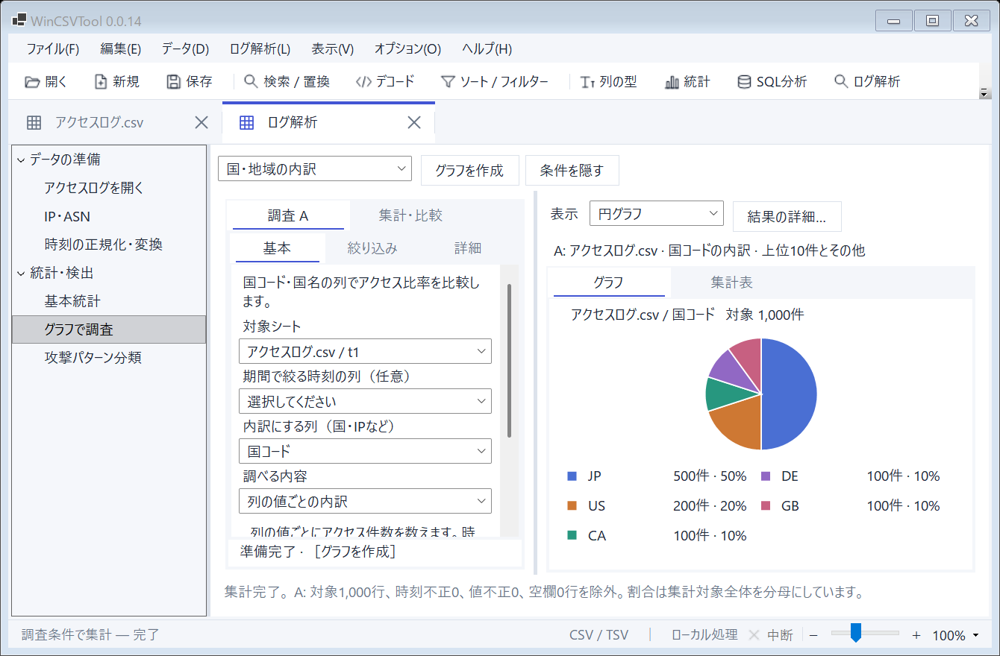

# WinCSVTool 0.1.0

大きなCSVやアクセスログを、Windowsで編集・調査するためのポータブルアプリです。表での編集、SQLによる集計、ログのグラフ化を1つのアプリで行えます。データの処理はPC内で完結します。

## できること

- **CSV・Excelの編集**：表形式で表示し、複数ファイルやシートをタブで切り替えます。先頭ゼロを保持し、ヘッダーのないCSVも扱えます。
- **検索と加工**：正規表現で検索・置換し、行や列の追加・削除、ソート、フィルター、URL／Base64デコードを行えます。
- **ログの調査**：nginx、Apache、Tomcat、JBoss EAP、AWS WAF、Cloudflare WAFのログとgzip圧縮ファイルを読み込めます。
- **IP・時刻・攻撃の分析**：オフラインで国・地域やASN・事業者を調べ、時刻を統一し、攻撃パターンを分類できます。
- **集計と可視化**：基本統計、404の時間推移、国別の割合などを確認できます。SQLでは複数の表をまとめて集計できます。

## 使い始める

公開版のZIPは[配布ページ](https://github.com/GustsMiseruken/WinCSVTool-Public/releases)から入手できます。配布されているバージョンは、リンク先で確認してください。

0.1.0の配布ZIPは、用途に合わせて3種類から選べます。

| 種類 | 使い方 | 入っているアプリ |
|---|---|---|
| GUI版 | 画面で表を編集・分析する | `WinCSVTool.exe` |
| CLI版 | コマンドで処理を実行する | `WinCSVTool.Cli.exe` |
| セット版 | 画面とコマンドの両方を使う | 上記の2つ |

どのZIPにも必要なIPデータ・説明書・ライセンスを含み、それぞれ単独で利用できます。.NETやExcelの追加インストールは不要です。

画面で使う場合は、GUI版またはセット版を選びます。

1. 配布ZIPを展開します。IP解析用データも使うため、**フォルダー全体**を展開してください。
2. `WinCSVTool.exe`を起動します。
3. ［開く］でCSV／XLSXを選ぶか、ファイルを画面へドラッグします。アクセスログは［ログ解析］→［アクセスログを開く］から開けます。

対象はWindows x64です。Windows 11など、[.NET 10のサポート対象OS](https://github.com/dotnet/core/blob/main/release-notes/10.0/supported-os.md)で利用してください。

**編集内容は自動保存されません。** 変更を残すには［保存］を押してください。



上の画面では、左側で調査条件を選び、右側にグラフと集計結果を表示しています。画面画像は旧版で撮影した操作例のため、ウィンドウ上部のバージョン表示は0.1.0と異なります。

## 基本の操作

| やりたいこと | 操作 |
|---|---|
| セルを編集する | セルをダブルクリック。長い値は下部の編集欄で直し、［セルに反映］ |
| 列を選ぶ／ソートする | 列記号のA・B・C…で選択、下段のヘッダー名で昇順・降順を切り替え |
| 行や列を追加・削除する | 列は右クリックメニュー、行は［編集］メニューから操作 |
| 条件に合う行を表示する | ［ソート / フィルター］で条件を指定して［適用］ |
| 文字を探す・置き換える | ［検索 / 置換］。正規表現にも対応 |
| URL／Base64を復号する | 対象セルを選び、［デコード］でプレビューを確認して適用 |
| 別のファイル・シートを見る | 上部のファイルタブ、下部のExcelシートタブで切り替え |

**［保存］は元の行順の全行、［表示結果を保存］は現在の並び順と絞り込み結果を保存します。** ソートやフィルターをかけた結果だけを出力するときは、［表示結果を保存］を使ってください。

**XLSXの保存は値だけが対象です。数式・書式・グラフは保持しません。** 元のブックとは別名で保存してください。

取り消せるのは、対応する直前の1操作です。セル編集・置換・デコードなどに対応し、列の追加・削除や型の変更は取り消せません。

<details>
<summary>文字コード・列の型・Excel保存について</summary>

- CSVの文字コードは自動判定のほか、UTF-8、Shift_JIS（CP932）、EUC-JP、UTF-16を指定できます。文字化けした場合は文字コードを選び直して開きます。開き直す前に未保存の変更を保存してください。
- 区切り文字はカンマ・タブ・セミコロンに対応します。ヘッダーのないCSVは、読み込み時にヘッダーの指定を外します。
- セルの値は文字列として保持します。［列の型］の自動・文字列・数値・日時・真偽値は、比較や集計の扱いを指定する設定です。元の値は書き換えません。
- XLSXの読み込みでは、数式の保存済み計算結果を使い、再計算はしません。
- 複数のCSVを1つのExcelブックにするには、［ファイル］→［複数の表をExcelブックに保存］を使います。
- XLSXの保存は1シートあたりヘッダーを含め1,048,576行、1セル32,767文字までです。行数が多い場合はCSVで保存してください。読み込みは1シート1,999列までです。旧形式の`.xls`や暗号化ブックには対応していません。

</details>

## ログを調べる

［ログ解析］を開き、目的に合う機能を選びます。設定を選ぶだけでは分析を開始せず、各画面の実行ボタンを押してから処理します。

| 機能 | できること |
|---|---|
| IP・ASN | 国・地域、国コード、IP区分、ASN、事業者などを調べ、選んだ情報だけを元の表へ列として追加 |
| 時刻の正規化・変換 | UNIX秒／ミリ秒、ISO 8601などを読み取り、JST／UTCやUNIX時刻へ変換して新しい列に出力 |
| 基本統計 | 選択範囲・フィルター結果・表全体の件数、合計、平均、最頻値、中央値、分散、標準偏差などを集計 |
| グラフで調査 | 時間ごとの件数・エラー率、国やIPごとの内訳をグラフ化 |
| 攻撃パターン分類 | リクエストやUAからSQLi、XSS、Path Traversal、LFI、RCE、SSRF、スキャンの特徴を検出 |

### よくあるグラフの作り方

［グラフで調査］でテンプレートを選び、対象の表と列を確認して［グラフを作成］を押します。

| 調べたいこと | 設定例 |
|---|---|
| 404件数の時間推移 | ［404エラーの時間推移］で日時列・HTTPステータス列を確認し、［集計・比較］で間隔を［1時間］にする |
| 国別アクセスの割合 | ［国・地域の内訳］で国コードや国名の列を選び、［表示］を円グラフにする |
| 特定の国からのアクセス | ［指定した国からのアクセス］を選び、［絞り込み］に`JP`など表と同じ値を入力する |
| 特定の国を除いた推移 | ［指定した国を除くアクセス］で除外する国を入力する |

IP列しかない場合は、先に［IP・ASN］で国名や国コードの列を追加すると、国別のグラフを作れます。

期間や条件は［絞り込み］、標準偏差や外れ値は［詳細］で設定します。条件を変えた後は、もう一度［グラフを作成］を押してください。グラフの形だけを変える場合は、再集計しません。

<details>
<summary>グラフの条件・割合・外れ値の見方</summary>

- **集計対象**：表の表示フィルターとは独立しています。グラフ側で期間・行範囲や最大2つの条件を指定します。複数条件は、すべてを満たす行が対象です。
- **数値の大小比較**：列の型にかかわらず数値として比較します。例えばテキスト型ASNでも、`ASN > 10000`は`13335`に一致し、`2497`には一致しません。比較値には有限の数値を入力します。対象列の空欄・非数値・NaN・無限大は、条件に一致しない行として集計から除きます。
- **国別などの割合**：集計対象全体を分母にします。上位項目以外は「その他」にまとめ、空欄は初期設定では分母からも除きます。内訳の時刻列は、期間を絞るときだけ指定します。
- **比較と表示形式**：時系列は最大2系列を左右の目盛りで比較できます。折れ線・棒・面・点、内訳は円・ドーナツ・横棒を選べます。ログのない時間帯を自動で0件にはせず、折れ線も欠測区間を結びません。
- **外れ値**：除外前の集計点の平均±1σ／2σ／3σで判定します。元ログの各値ではなく、グラフの各集計点に対する母集団標準偏差です。除外した点はグラフ・集計表・CSVから外れます。［結果の詳細］で点数・除外件数・判定基準を確認できます。
- **結果の保存**：画面は時系列を最大1,000点ずつ表示します。［集計表］→［CSVへ保存］は全点を出力します。元データが変わると、再集計が必要です。

</details>

**IPの国・地域や攻撃分類は参考情報です。** IP情報は利用者の国籍や現在地を示すものではなく、攻撃分類も攻撃の成功・悪意・安全性を確定しません。原文と照らし合わせて判断してください。

<details>
<summary>アクセスログの読み込み設定</summary>

［アクセスログを開く］でログ形式・文字コード・実際の出力書式を指定します。テキストログでは、引用符や角括弧を含む書式に従って読み込みます。引用符内のスペースでは分割しません。

書式欄には`log_format`や`LogFormat`などの設定行全体ではなく、次のような**書式本体**を入力します。

| 形式 | 書式本体の例 |
|---|---|
| nginx | `$remote_addr - $remote_user [$time_local] "$request" $status $body_bytes_sent "$http_referer" "$http_user_agent"` |
| Apache／Tomcat／JBoss EAP 6 | `%h %l %u %t "%r" %s %b "%{Referer}i" "%{User-Agent}i"` |
| JBoss EAP 7/8 | `%h %l %u %t "%r" %s %b "%{i,Referer}" "%{i,User-Agent}"` |

［文字の表現］もログ出力側のエスケープ設定に合わせます。nginxで日本語が`\xHH`として出力される場合、元の文字コードを自動判定できないことがあります。CP932のログは文字コードを明示指定してください。

AWS WAF／Cloudflare WAFは、1行に1つのJSONを持つJSON Lines形式が対象です。取り込む列は`timestamp,httpRequest.clientIp,action`のように指定します。Cloudflareなどのフィールド名は、実際の出力設定に合わせてください。

`.csv.gz`や`.log.gz`も展開せずに開けます。読み込んだアクセスログは、元ログとは別のCSV・CSV.gz・XLSXへ保存します。

</details>

<details>
<summary>IP情報・時刻変換・統計・攻撃分類の補足</summary>

- **IP情報**：同梱のDB-IP Lite 2026-10-01版を使い、ネット接続やDNS照会は行いません。プライベートIPなどは区分を表示します。基準日・出典は［参照データの詳細］、国名の日本語／英語は［環境設定］で確認・変更できます。
- **時刻変換**：入力の時差を優先し、時差がない場合は指定したJST／UTCで解釈します。変換結果は新しい列に追加し、元の列は保持します。解釈できない値は空欄になります。
- **統計**：文字列には件数・最頻値・異なる値の数など、数値には合計・平均・中央値・四分位数・分散・標準偏差などを取得できます。空欄・非数値を0に置き換えません。数値計算は倍精度浮動小数点です。
- **攻撃分類**：［先頭100行で確認］で理由と確認状態を見てから、全行へ分類列を追加できます。各値の先頭65,536文字を上限として照合します。上限・不正なエンコード・タイムアウトで判定を完了できない場合もあります。

</details>

## SQL・コマンドライン

［SQL分析］でクエリを入力し、［実行］またはCtrl+Enterで実行します。複数のクエリはタブで管理できます。表名・列名は一覧をダブルクリックすると入力できます。

```sql
SELECT * FROM t1 LIMIT 20;
```

複数の表を結合して集計し、結果を新しいCSVタブやファイルへ保存できます。実行できるのはSQLiteの`SELECT`／`WITH`による読み取り専用クエリです。表の表示フィルターは自動適用されないため、必要な条件は`WHERE`に記述してください。

画面のプレビューは最大1,000行です。［全結果をCSVに保存］では全結果を保存できます。

<details>
<summary>CLIの使い方とコマンド例</summary>

CLI版またはセット版をフォルダーごと展開すると、`WinCSVTool.Cli.exe`で画面を開かずに変換・SQL・検索・置換・統計・IP解析などを実行できます。詳しい引数は`help`で確認してください。以下はPowerShellの例です。

```powershell
# 操作とオプションの一覧
.\WinCSVTool.Cli.exe help

# CSVにSQLを実行して保存
.\WinCSVTool.Cli.exe sql --input access.csv --query 'SELECT * FROM t1 LIMIT 20' --out result.csv

# 圧縮されたnginxログを、指定した書式でCSVへ変換
.\WinCSVTool.Cli.exe convert --input access.log.gz --log-format nginx --log-pattern-file format.txt --out access.csv.gz

# オフラインでIPを照会
.\WinCSVTool.Cli.exe ip-lookup --address 8.8.8.8 --country-language ja
```

入力は`--input`、保存先は`--out`で指定します。`--encoding`で文字コード、`--no-header`でヘッダーなし、`--sheet`でExcelシートを選べます。SQLやブックへの変換では、`--input`を繰り返して複数のファイルを指定できます。入力に名前を付けない場合、SQLの表名は`t1`、`t2`…になります。

</details>

## 環境設定と利用時の注意

［オプション］→［環境設定］で、作業フォルダー、テーマ、フォント、表示行数、ショートカット、CSV入出力の既定値、SQL画面の配置を変更できます。表示倍率は右下のバーで調整できます。

大容量ファイルは、全行をメモリに載せず、ディスク上の作業データを使って処理します。2コア・16GB未満の環境で数GB・数百万〜数千万行を扱うことを設計目標としています。初回の読み込みや全件集計には時間がかかり、作業ディスクの空き容量も必要です。元ファイルの2〜4倍程度を目安にし、余裕を持たせてください。

<details>
<summary>表示・保存・復旧で困ったとき</summary>

- 表は初期設定で512行ずつ表示します。表示行数はCSV全体の行数制限ではありません。［環境設定］で100〜10,000行に変更できます。
- 作業データは初期設定ではWindowsの一時フォルダーに置き、正常終了時に削除します。保存先は変更できますが、反映は次回起動時からです。
- 異常終了後は作業データの復旧を選べますが、すべての状態を戻せるとは限りません。重要な変更はファイルへ保存してください。
- 設定はEXEと同じフォルダーの`.local/settings.json`へ保存します。設定を持ち運ぶには、フォルダーごと移動してください。
- ExcelなどでCSVを開く際は、保存画面の［表計算ソフトでの数式解釈を防ぐ］を選べます。式に見える値へアポストロフィを付けるため、元のCSVとは別の出力として扱ってください。
- 1つの作業領域で開ける表は最大1,024個です。XLSXのシートも1表として数えます。

</details>

<details>
<summary>開発者向け：構成とビルド</summary>

WinCSVToolは、大容量CSVの編集とセキュリティログ調査に使うWindows向けアプリです。C#／.NET 10／Windows Formsで画面を作り、SQLiteに作業データを置きます。CLIも同じデータ処理を使います。XLSXはZIP／XMLとして読み書きし、IP解析には同梱データを使います。外部APIのキーは不要です。

ソースからのビルドには、Windows x64と`global.json`で指定した.NET SDK 10.0.402が必要です。

```powershell
dotnet restore WinCSVTool.sln --locked-mode
dotnet build WinCSVTool.sln -c Release --no-restore
dotnet run --project src/WinCSVTool
```

ポータブルZIPの作成：

```powershell
powershell -ExecutionPolicy Bypass -File scripts/publish-portable.ps1
```

`artifacts/`にEXE・IPデータ・説明書・ライセンスと、GUI版・CLI版・セット版の3つのZIPを出力します。各EXEは100,000,000バイト未満で作成し、SHA-256一覧も生成します。署名証明書を指定しない場合は未署名です。

</details>

## ライセンス

本体は[MIT License](LICENSE)です。著作権表示・許諾文を保持する条件で、商用・非商用とも無償で利用・改変・再配布できます。依存ソフトウェアの条件は[THIRD-PARTY-NOTICES.txt](THIRD-PARTY-NOTICES.txt)を参照してください。

IP Geolocation and ASN data by [DB-IP.com](https://db-ip.com/)。同梱のDB-IP Liteと派生ASN索引は[CC BY 4.0](data/ip/LICENSE-CC-BY-4.0.txt)です。出典・基準日・変更内容は[IPデータの説明](data/ip/README.md)に記載しています。
